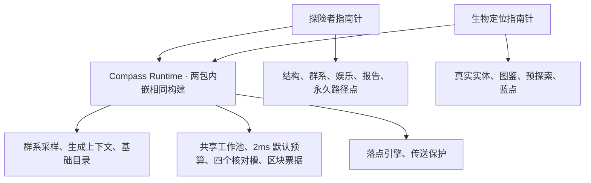

# 双指南针 · Minecraft 1.20.1 Forge

**1.3.3 为性能候选构建：六项冷态全程均未达到1秒，不能宣传为一秒加速已完成。**

两个独立模组，可单装，也可同装。需要 Java 17；验收环境为 Forge 47.4.18。两个文件各自内嵌相同的 Compass Runtime，玩家无需额外安装前置。

| 产品 | 版本 | 模组 ID | 协议 |
| --- | --- | --- | --- |
| [探险者指南针 统一](modules/explorer/README.md) | 1.3.3 | `explorerscompass` | `explorer-1` |
| [生物定位指南针](modules/creature/README.md) | 1.0.2 | `creaturecompass` | `creature-1` |

## 安装和迁移

1. 退出游戏并备份存档和配置。移除旧统一版、原版 Explorer’s Compass、Edited、Enhance 及旧 filters 扩展；不要将它们与拆分版同装。
2. 将需要的产品 jar 放入 `mods`。客户端和服务端必须使用相同产品组合和匹配版本。不要将开发用的合体 jar 或单独的核心 jar 放入 `mods`。
3. 原探险者指南针 ID 和历史统计不变。**旧生物指南针不迁移**：旧存档可能提示缺失物品，确认已备份后再继续，进游戏用指南针和腐肉重新制作。
4. 原探险者配置继续使用。生物版配置为 `creaturecompass-common.toml`、`creaturecompass-client.toml`；公共预算为 `compass-runtime-common.toml`。首次缺少新配置时读取可迁移的旧值，旧文件保留；已有新文件优先。两种指南针的传送开关、模式、筛选和搜索参数分别设置。

## 源码与构建

`gradlew.bat assembleSplit` 构建两个候选安装包，输出到 `build/split-candidates/`。Gradle 的 `runtime`、`explorer`、`creature` 分别编译；构建使用一次 Forge 重映射，再分包并检查编译产物不能跨产品引用。不要发布中间产物。

两个产品独立注册物品、网络、界面与配置。核心统一控制前台任务替换及预算；低优先级预探索不抢占前台。拆分不重写搜索算法。[1.2.8 搜索架构](docs/search-architecture-1.2.8.md)仍适用于探险者搜索内部。新增的[传送与灾变架构](docs/explorer-architecture-1.3.3.md)说明 1.3.3 的调整。

Explorer’s Compass Unified 由 David 维护，基于 ChaosTheDude / MattCzyr 的 Explorer’s Compass Forge 1.20.1 1.4.0，非官方衍生版本。见 [许可证](LICENSE.md)、[署名](NOTICE.txt)、[第三方说明](THIRD_PARTY.md)。
