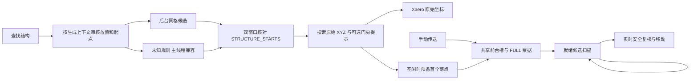

# 1.3.2：探险者指南针的传送与结构预测

搜索候选和传送区块准备不是同一个阶段。结构核对不需要把区块生成到可落地状态；落点读取始终在服务端线程且要求对应区块已经完整。手动请求按维度和区块共享票据，取消或终止后释放自己的引用。普通候选、宝藏同列及要塞门旁都保留最终复核。娱乐旅行和生物指南针继续各自的既有安全与落点策略。

灾变的放置审核读取运行时已注册对象，跟随整合包覆盖；起点审核限定已核对入口和模板。生成点只是候选，结构的真实起始记录才是成功证据。
