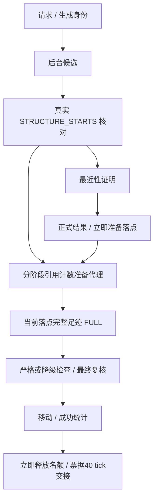

# 1.3.3 搜索—传送准备

## 实测后撤回的设计

两种提前 FULL 预生成均拖慢冷态沉沦之城：未核实候选全程10.049秒、已核实但未证明最近候选7.899秒，基线4.265秒。候选版本均废弃；最终版等最近性证明完成后才准备 FULL，不宣称具备尚未验证收益的重叠预生成。

## 保留的修复

- 准备代理按世界身份和区块合并阶段需求，绑定生成代次；升级先加后减，释放不取消 Minecraft Future。
- 按当前落点一次保留全部依赖，不逐出仍需要的足迹；相邻候选先添加新引用再释放旧引用。
- 准备幂等；普通预备等待最多30秒，就绪后缓存30秒；成功保温不占核对名额。
- 快速降级检查仅在中心 FULL 就绪后标记完成；普通目标优先尝试同区块内部，避免角落先等四块；宝藏与门房走各自原规则。
- 每tick建立任务快照，保留共享2毫秒预算；修正后续区块等待计时。

源区块、搜索锚点、门户落点不混用。传送服务完整策略拆分尚未完成，本轮抽离准备代理与足迹计算。不得将本轮产物描述为已达到所有冷区块1秒目标。
