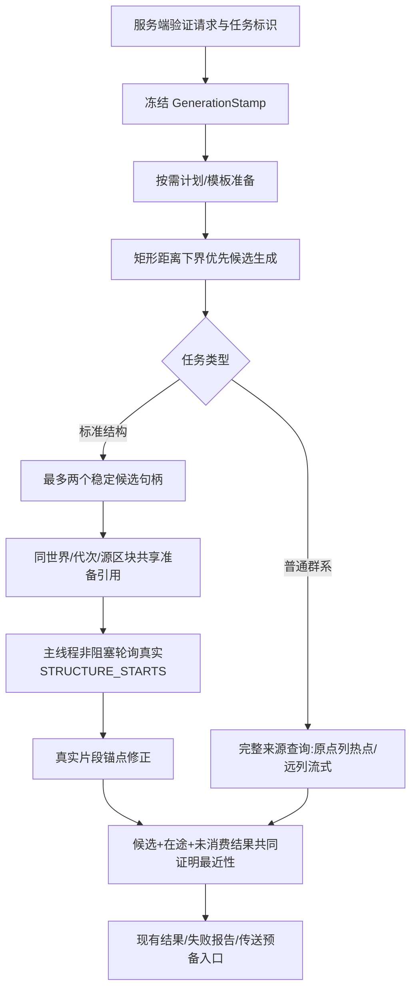

# 1.2.8 搜索架构

仅标准StructureSearch启用新窗口；普通群系及特殊地物保持原确认协议。协议unified-8、半径和采样集合不变。

## 生命周期

GenerationStamp严格比较生成器、来源、完整RandomState、Sampler、RegistryAccess身份与重载代次，不调用它们的equals。新请求不复用失效快照；搜索会话也在提交结果前检查标识。SAFE/NOT_READY/UNSUPPORTED仍由来源审核决定；不强行开启未知来源的异步。

首窗口参与现有全局FIFO；次窗口仅在没有前台等待时领取余槽。全服务器仍最多四个槽。相同源区块的多个候选分别核对真实结构，只共享准备Future与ticket；引用清零后释放，不cancel Minecraft的共享Future。次窗口晋升时，未持槽则改走前台队列。

普通预测前沿不扩大。缺少第二候选时，稳定首窗口的同一等待epoch仅额外允许一次微批次，最多256次或4ms、首个非空采样即停，不后台自链；空批次及次窗拒绝不重置epoch。已提交批次在窗口填满后停止继续采样。

## 统计与验收限制

结构诊断增加共享准备次数、逻辑窗口峰值、槽位等待和区块等待的墙钟区间并集。各阶段可能重叠，不能直接相加当成端到端耗时。原主线程计时包含核对执行，不能重复求和。

已完成：新优化版完整副本3目标冷/热12请求，实际ID/XYZ一致且资源归零；最终正式二进制又完成一次青铜地牢搜索和同区块共享准备引用计数探针。来源调用、原点缓存命中及整次查询缓存命中已实现，来自分片独占普通long，批次/主线程微批次结束发布快照；不从samples推断。计数是终态时已发布批次，取消后尚在收尾的批次不强制阻塞主线程等待。单次基本对比不代表全部模组环境或固定加速倍数。

### 诊断发布

`source_calls`计入实际调用完整BiomeSource入口（包含抛异常的调用尝试），缓存加载器复用不重复计入；不统计包装来源内部的递归子调用。`origin_cache_hits`计入起点列已完成值或缓存加载结果复用；命中可以与配额争抢独立，不等同逻辑samples。`column_builds`为实际创建的列对象数；`query_memo_hit`仅指构造时完整查询前缀命中，不会因完成后写入前缀而误报命中。每分片使用独占long，不逐点原子加锁/日志，批次结束才通过volatile不可变快照汇总。旧共享方法签名保留，生物指南针不绑定这些诊断钩子。
