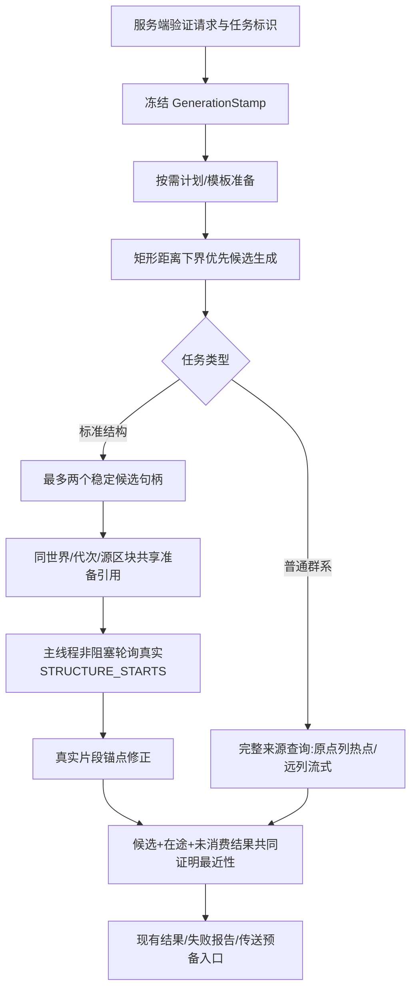

# 1.2.8 搜索架构（开发中）

仅标准StructureSearch启用新窗口；普通群系及特殊地物保持原确认协议。协议unified-8、半径和采样集合不变。

## 生命周期

GenerationStamp严格比较生成器、来源、完整RandomState、Sampler、RegistryAccess身份与重载代次，不调用它们的equals。新请求不复用失效快照；搜索会话也在提交结果前检查标识。SAFE/NOT_READY/UNSUPPORTED仍由来源审核决定；不强行开启未知来源的异步。

首窗口参与现有全局FIFO；次窗口仅在没有前台等待时领取余槽。全服务器仍最多四个槽。相同源区块的多个候选分别核对真实结构，只共享准备Future与ticket；引用清零后释放，不cancel Minecraft的共享Future。次窗口晋升时，未持槽则改走前台队列。

普通预测前沿不扩大。缺少第二候选时，稳定首窗口的同一等待epoch仅额外允许一次微批次，最多256次或4ms、首个非空采样即停，不后台自链；空批次及次窗拒绝不重置epoch。已提交批次在窗口填满后停止继续采样。

## 统计与验收限制

结构诊断增加共享准备次数、逻辑窗口峰值、槽位等待和区块等待的墙钟区间并集。各阶段可能重叠，不能直接相加当成端到端耗时。原主线程计时包含核对执行，不能重复求和。

尚未完成：完整yzzz3独立副本冷/热12请求、真实共享ticket/Future生命周期游戏验收，以及来源调用/缓存命中的细化性能计数。不承诺已实测提速；开发jar不标记正式通过。
